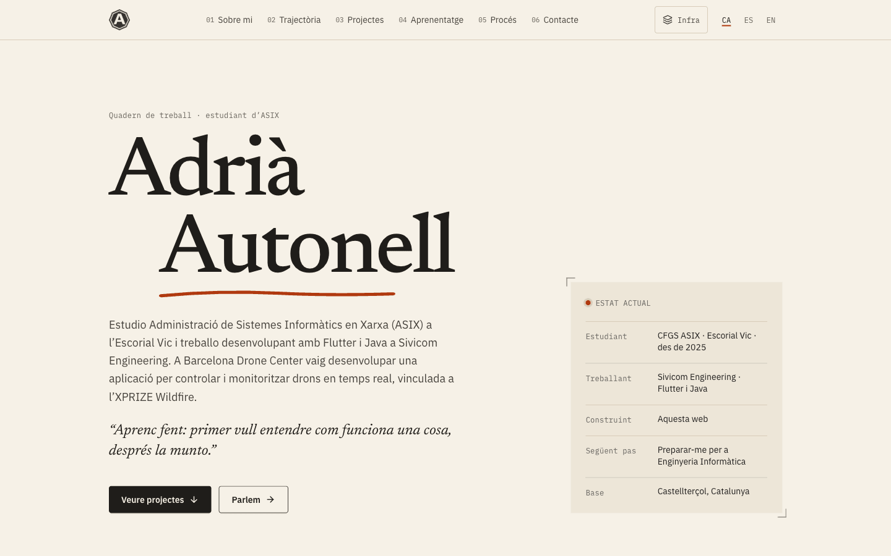
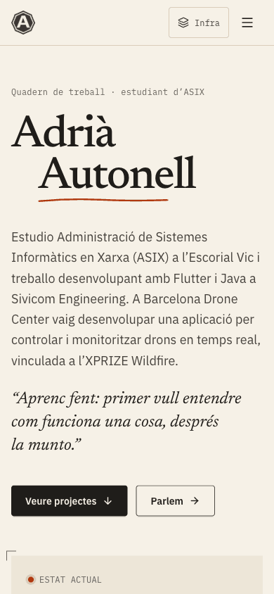
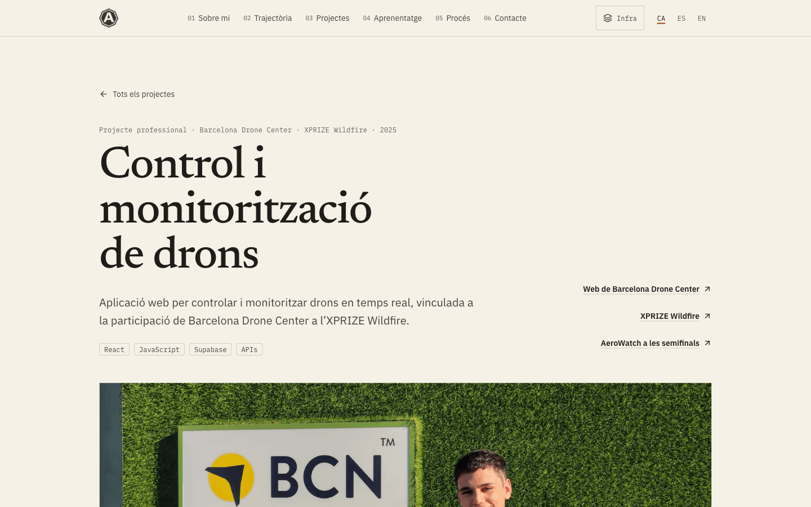

# Adrià Autonell — Personal Portfolio

**Web:** [adria-autonell.com](https://adria-autonell.com/) · **Código:** [github.com/adria-autonell/web-adria-autonell](https://github.com/adria-autonell/web-adria-autonell) · **LinkedIn:** [linkedin.com/in/adriaautonell](https://www.linkedin.com/in/adriaautonell)

Mi web personal. Estudio Administración de Sistemas Informáticos en Red (ASIX) y aquí cuento quién soy, de dónde vengo, qué proyectos he desarrollado y qué estoy aprendiendo.

La construí para tener un sitio propio, más allá de un currículum, y para que la propia web fuera un proyecto real: publicado, documentado y con decisiones que puedo explicar. En ella hay:

- Mi trayectoria académica y profesional, y los concursos de programación en los que he participado.
- Proyectos explicados como casos: el reto, mi aportación, las decisiones técnicas y lo que aprendí.
- Dónde estoy con cada tecnología, sin porcentajes inventados.
- Mi forma de trabajar y un registro de cambios de la web.

Está disponible en catalán, castellano e inglés.

## Vista previa



<p>
  
  &nbsp;
  
</p>

Capturas reales tomadas con Playwright sobre la versión de producción.

## Tecnologías

| Categoría | Herramientas |
|---|---|
| Frontend | React 19, TypeScript, React Router 7 |
| Estilos | Tailwind CSS 4 (tokens en `@theme`), tipografías Newsreader, IBM Plex Sans e IBM Plex Mono alojadas con Fontsource |
| Iconos | lucide-react (los logotipos de LinkedIn y GitHub están dibujados en `BrandIcons.tsx`) |
| Animaciones | CSS: transiciones, animaciones ligadas al scroll como mejora progresiva y `prefers-reduced-motion`. Sin librerías de animación |
| Build | Vite 8 (build de cliente + build SSR para el prerender) |
| Imágenes | sharp (AVIF, WebP, iconos y Open Graph) |
| Pruebas y calidad | Playwright (MCP), Lighthouse y scripts propios de enlaces y contraste |
| Despliegue | Cloudflare Workers (archivos estáticos) con Wrangler |

## Funcionalidades

- **Tres idiomas** con rutas propias: catalán en la raíz (`/`), castellano en `/es` e inglés en `/en`, con `hreflang` y selector que conserva la página.
- **Índice de sección activa**: la cabecera marca con `aria-current` la sección visible (IntersectionObserver). En móvil, en lugar del índice completo, se muestra solo la sección actual.
- **Proyectos como casos de estudio**, cada uno con su página.
- **Trayectoria** con formación, experiencia, Fundació Impulsa y concursos de programación.
- **Modo «Ver la infraestructura»**: superpone la retícula de 12 columnas, nombra los componentes y explica el recorrido de cada petición.
- **HTML prerenderizado** de todas las páginas: buscadores y vistas previas de enlaces ven el contenido sin ejecutar JavaScript.
- **SEO**: títulos y descripciones por página, canonical, Open Graph, Twitter Cards, JSON-LD, `sitemap.xml` y `robots.txt`.
- **Página 404** propia en los tres idiomas.
- **Accesibilidad**: navegación completa con teclado, enlace para saltar al contenido, foco visible, contrastes WCAG 2.2 AA y textos alternativos.
- **Privacidad**: sin cookies, analítica ni peticiones a terceros. Política de privacidad y aviso legal en los tres idiomas.

## Arquitectura

```
web-adria-autonell/
├── src/
│   ├── components/   Piezas reutilizables: Header, Footer, Section, LangSwitch, InfraToggle…
│   ├── sections/     Secciones de la portada: Hero, About, Timeline, Projects, Learning, Process, Contact, Log
│   ├── pages/        Home, ProjectPage, LegalPage, NotFound
│   ├── hooks/        Sección activa, modo infraestructura y efectos de navegación
│   ├── data/         Todo el contenido editable, en tres idiomas
│   ├── i18n/         Idiomas, rutas por idioma y textos de interfaz
│   ├── styles/       Tokens de diseño y estilos globales
│   ├── seo.ts        Metadatos, canonical, hreflang y JSON-LD
│   ├── entry-server.tsx  Render en servidor usado por el prerender
│   └── main.tsx      Entrada del cliente (hidratación)
├── public/           Favicons, logotipo, imágenes optimizadas, Open Graph, _headers y _redirects
├── assets-src/       Originales de imágenes y logotipo (no se publican)
├── scripts/          Prerender, imágenes, enlaces, contraste y pendientes
├── docs/
│   ├── design/       Análisis de la identidad visual (tokens y principios)
│   └── screenshots/  Capturas de este README
├── wrangler.jsonc    Configuración de Cloudflare
└── LICENSE
```

El contenido no está mezclado con los componentes. Cada texto es un objeto `{ ca, es, en }` dentro de `src/data/`, de modo que actualizar un proyecto o una fecha no obliga a tocar el diseño. Lo que todavía no está confirmado se escribe como `pending('…')`: se ve como una etiqueta en desarrollo y nunca se publica en producción.

## Instalación local

Requisitos: Node.js 22 o superior y npm.

```bash
git clone https://github.com/adria-autonell/web-adria-autonell.git
cd web-adria-autonell
npm install
npm run dev        # servidor de desarrollo en http://localhost:5173
npm run build      # build de producción y prerender en dist/
npm run preview    # sirve dist/ en http://localhost:4173
npm run cf:dev     # build + Cloudflare en local (cabeceras y redirecciones reales) en http://localhost:8787
```

Comprobaciones:

| Script | Qué hace |
|---|---|
| `npm run typecheck` | Comprobación de tipos con TypeScript |
| `npm run check-links` | Revisa enlaces internos, anclas y enlaces externos del HTML generado (requiere `npm run build`) |
| `npm run contrast` | Calcula el contraste de la paleta según WCAG 2.2 AA |
| `npm run pending` | Lista el contenido pendiente de confirmar |
| `npm run images` | Regenera imágenes, logotipo, favicons e imágenes Open Graph desde `assets-src/` |

El proyecto no tiene tests automatizados ni linter configurados. Las pruebas de navegador se hicieron con Playwright (ver [Calidad y pruebas](#calidad-y-pruebas)).

## Diseño y decisiones técnicas

**Sistema visual.** La idea es un «cuaderno de trabajo»: papel crema `#f6f1e7`, tinta `#1f1d1a` y un único acento, el rojo minio `#b0390f`. El minio aparece solo en números, subrayados y estados activos, así que cuando se ve indica dónde estás. No hay sombras: la jerarquía sale de dos tonos de fondo y líneas de 1 px. Hay tres tipografías con papeles fijos: Newsreader para títulos, IBM Plex Sans para el texto e IBM Plex Mono para fechas, números y etiquetas. El análisis completo está en [`docs/design/`](docs/design/adria-autonell.com.md).

**Componentes.** `Section` define la estructura de cada entrada (número, título, contenido y notas al margen) y las secciones de la portada solo aportan contenido. Los números de sección salen de `src/data/sections.ts`, de modo que el índice y los títulos no se desincronizan.

**Responsive.** Retícula de 12 columnas en escritorio (etiqueta, contenido y margen en proporción 3/6/3) que se apila en móvil. Se ha revisado a 375, 768, 1024, 1280 y 1440 px.

**Navegación.** El índice usa IntersectionObserver en vez del evento `scroll`. Una sección cuenta como activa cuando ocupa la franja central de la pantalla. El scroll suave solo se aplica si la persona no ha pedido reducir el movimiento, y `scroll-margin` evita que la cabecera fija tape los títulos.

**React y prerender.** React se usa para componer la interfaz y gestionar el estado (idioma, sección activa, menú y modo infraestructura). En el build cada ruta se renderiza a HTML estático (`scripts/prerender.mjs`) y el navegador lo hidrata. La 404 puede servirse en cualquier URL, así que no se hidrata: se vuelve a renderizar.

**Recursos.**
- Imágenes en AVIF y WebP a 800 y 1600 px, con dimensiones explícitas (CLS 0) y carga diferida.
- Las fotos se procesan sin metadatos EXIF.
- Solo se cargan los caracteres latinos de las tipografías.

**Seguridad.**
- CSP estricta sin `unsafe-inline`, HSTS, `X-Content-Type-Options`, `Referrer-Policy`, `Permissions-Policy` y `X-Frame-Options`, todo en `public/_headers`.
- La web no necesita claves ni secretos. La única variable de entorno, `VITE_SITE_URL`, es pública.

## Retos técnicos

Problemas reales que aparecieron durante el desarrollo:

- **Hidratación de la 404.** La página de error se genera una sola vez pero Cloudflare la sirve en cualquier URL, también bajo `/es` o `/en`. Hidratarla producía desajustes, así que se renderiza de nuevo en el cliente y se ajustan título e idioma según la URL.
- **CSP sin estilos inline.** Obliga a no usar atributos `style` ni scripts inyectados. Incluso la generación de las imágenes Open Graph tuvo que hacerse fuera del dominio con CSP.
- **Primer despliegue en Cloudflare.** Sin un archivo de configuración, Wrangler intentaba configurar el proyecto por su cuenta, modificaba el build SSR de Vite y el prerender fallaba. Se resolvió con un `wrangler.jsonc` explícito.
- **Animaciones ligadas al scroll.** Con `animation-fill-mode: both`, las secciones fuera de pantalla quedaban invisibles en capturas e impresiones. Ahora el contenido siempre es visible fuera del rango de la animación.
- **URL canónica en la raíz.** Para que la portada fuera `https://adria-autonell.com/` sin redirecciones, el catalán pasó a vivir en la raíz y las URLs antiguas con `/ca` se redirigen de forma permanente (`public/_redirects`).

## Calidad y pruebas

**Playwright (MCP)** sobre la build de producción servida con `wrangler dev`:

- 17 rutas (las 15 páginas en tres idiomas y dos URLs inexistentes) a 375, 768 y 1440 px: sin desbordamiento horizontal, sin imágenes rotas y sin errores en consola.
- Índice: las seis entradas llevan a su sección con el título visible bajo la cabecera, y `aria-current` se actualiza al hacer scroll y al pulsar.
- Teclado: orden de tabulación, enlace para saltar al contenido y activación con Enter.
- Menú móvil: apertura, cierre con Escape y cierre al navegar.
- Selector de idioma: conserva la página y actualiza título y `lang`.
- Redirecciones: `/ca/*` → `/*` (301) y rutas inexistentes → 404.

**Enlaces.** `npm run check-links`: 0 enlaces internos o anclas rotos; el mismo script comprueba también los enlaces externos.

**Contraste.** `npm run contrast`: todos los pares de texto cumplen WCAG 2.2 AA (mínimo 4,92:1).

**Lighthouse 13.5** (móvil salvo indicación), sobre la build local servida con las cabeceras de Cloudflare:

| Página | Performance | Accessibility | Best Practices | SEO |
|---|---|---|---|---|
| `/` | 93 | 100 | 100 | 100 |
| `/` (escritorio) | 100 | 100 | 100 | 100 |
| `/projects/barcelona-drone-center` | 93 | 100 | 100 | 100 |
| `/es/projects/portfolio` | 94 | 100 | 100 | 100 |
| `/en/privacy` | 95 | 100 | 100 | 100 |

CLS 0 en todas. Son medidas locales: los resultados en producción pueden variar.

## Despliegue

La web está publicada en **[adria-autonell.com](https://adria-autonell.com/)** con **Cloudflare Workers** (archivos estáticos, sin código de servidor), según `wrangler.jsonc`.

- Cloudflare clona el repositorio en cada push a `main`, ejecuta `npm run build` y despliega con `npx wrangler deploy`.
- Variable de build: `VITE_SITE_URL=https://adria-autonell.com`. Se usa en canonical, Open Graph, sitemap y robots.txt.
- Cloudflare sirve `dist/` con `html_handling: auto-trailing-slash`, de modo que `/es/privacy` sirve `es/privacy.html`, y usa `404.html` para las rutas inexistentes.
- `public/_headers` define las cabeceras de seguridad y la caché; `public/_redirects`, las redirecciones permanentes.

Despliegue manual desde local (opcional): `npm run deploy`.

## Versión

**v1.0.0 — Primera versión pública.**

## Licencia

El código está bajo licencia [MIT](LICENSE). Los textos, las fotografías y el logotipo no están incluidos en esa licencia: todos los derechos reservados.

## Autor

**Adrià Autonell**

[adria-autonell.com](https://adria-autonell.com/) · [GitHub](https://github.com/adria-autonell) · [LinkedIn](https://www.linkedin.com/in/adriaautonell)
